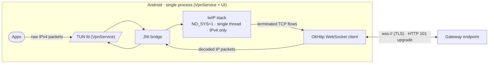
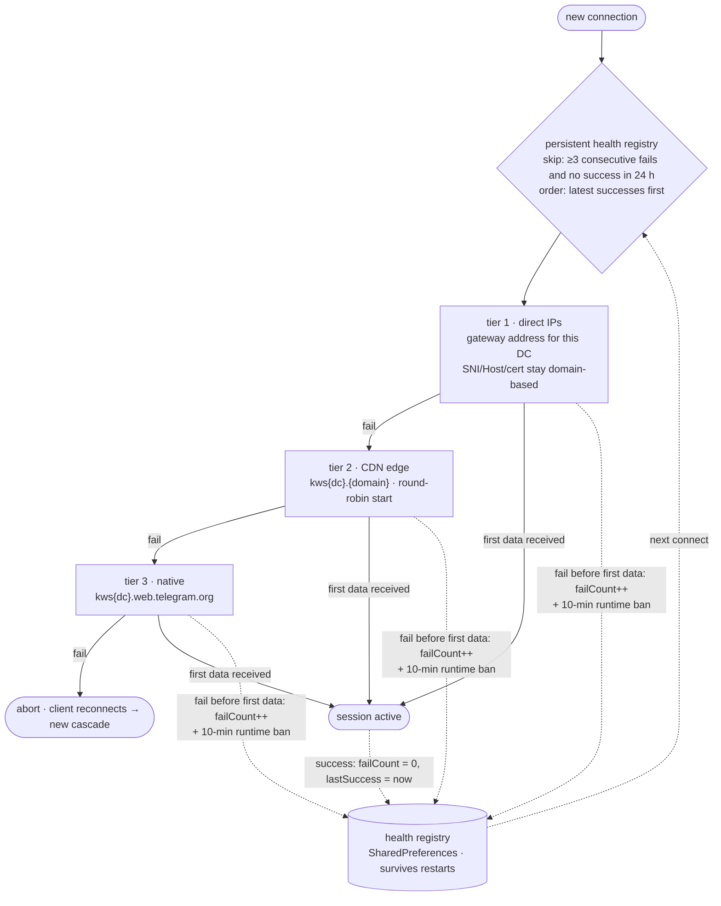

# WSBridge

IP-over-WebSocket relay for Android (VpnService). Russian version: [README.ru.md](README.ru.md)

## What it does

The app creates a virtual network interface (TUN) and carries the IPv4
traffic of Telegram ranges through it as a WebSocket stream:



1. The system routes Telegram-range IPv4 traffic into the TUN fd
   (`149.154.0.0/16`, `91.108.0.0/16`, `91.105.192.0/24` — nothing else).
2. The vendored lwIP stack (2.2.0, single-threaded, `NO_SYS=1`, IPv4-only)
   terminates TCP and re-emits each flow as WebSocket frames.
3. Frames travel over TLS (`wss://`) to an HTTP endpoint that upgrades
   (status 101) and relays the stream.
4. Responses are decoded back into IP packets and written to the TUN.

Unlike the iOS original there is no IPC layer: the service and the UI live
in one process, so the journal and the status are read directly. lwIP has
no UDP of its own, so DNS from the tunnel is forwarded by `DNSForwarder`
as plain UDP:53 to the selected server.

The 64-byte MTProto init is parsed on the fly. Telegram Android does not
embed `dc_idx` into the init without a proxy secret, so the DC is derived
from the destination address (built-in IP→DC table) and the `dc_idx` bytes
are rewritten in place (keystream XOR) to match the chosen gateway host.

Additional modes (the "CF Worker" field in the menu):
- **pipe** — your own Cloudflare Worker: the raw TCP stream goes into WS,
  the worker connects to the DC itself;
- **relay** — a direct relay on your VPS: `host:port`, raw TCP, no CF/WS.

## Endpoint selection

Connections are established through an ordered cascade:



- **Direct IPs** — gateway addresses proven to serve this DC (the gateway
  picks its certificate by SNI, so an IP is only used where the cert
  covers the host); TCP goes to the IP while SNI/Host/validation stay
  domain-based via a custom DNS resolver.
- **CDN edge** — `kws{dc}.{domain}` hosts, resolved and rotated
  round-robin; the prefix of live endpoints is preferred.
- **Native** — `kws{dc}.web.telegram.org` as the final fallback
  (`kws{dc}-1` for media DCs).

The per-endpoint health registry survives restarts: consecutive failures,
last failure and last success timestamps. Endpoints with ≥3 consecutive
failures and no success within 24 h are excluded until recovery; most
recent successes are tried first. A runtime cache additionally bans a
failed endpoint for 10 minutes inside the running session.

## Endpoint list updates

The endpoint list is hot-updatable without rebuilding the app:

1. The app fetches the list from the origin URL, falling back to two
   CDN mirrors (10 s timeout, cache bypass).
2. Each entry is validated by format and DNS resolution; a list where
   fewer than 3 entries resolve is discarded as stale.
3. Validated entries are merged into the persistent registry — the
   built-in list always stays first as an immutable fallback; known-live
   entries are never re-tested, dead ones get a DNS re-check, entries
   dead for 7 days and absent from the upstream list are evicted.
4. The registry feeds the cascade on the next tunnel start.
   Auto-refresh is rate-limited to once per 30 minutes and runs after
   tunnel start, not before it. A manual "Update fronts" menu item shows
   the result as a snackbar.

## DNS

DNS from inside the tunnel is forwarded as plain UDP:53 by
`DNSForwarder` to the selected server — lwIP has no UDP of its own.
Presets (system / Google / Cloudflare / Comss.one / Malw.link) and custom
plain-IP servers are configurable in-app; DoH/DoT are deliberately not
ported (encrypted DNS is the job of the system private DNS). Changes take
effect on the next tunnel start.

## Install

Download the APK from [Releases](https://github.com/l1ratch/WSBridge-Android/releases);
the dev build of the latest `main` push lives in the `preview` prerelease.
All builds share one signing key and a growing `versionCode`, so updates
install in place. (The first switch away from an old debug build needs one
manual uninstall — those were signed with a random key.)

## Build

- Gradle wrapper; CI (GitHub Actions) builds a signed APK on every push
  to `main` and publishes it to the `preview` prerelease; `versionCode`
  comes from the CI run number.
- Local: JDK 17+ (CI uses 21), Android SDK 36, NDK 27+, CMake. The native
  part (lwIP 2.2.0 + JNI bridge, `app/src/main/cpp/`) builds via
  externalNativeBuild.

```sh
./gradlew testDebugUnitTest assembleRelease
```

## Differences from the iOS version

- `PacketTunnelProvider` → `VpnService` (TUN fd instead of NEPacketFlow);
- `URLSessionWebSocketTask` → OkHttp WebSocket; direct gateway IPs go
  through a custom DNS resolver (SNI/Host/certificate stay domain-based,
  TCP goes to the IP);
- no IPC layer (Darwin notifications, JournalServer): the service and the
  UI share one process, the journal is read directly;
- the DNS forwarder is live (on iOS the system NEDNSSettings replaced it;
  there it was dead code);
- DoH/DoT presets are not ported: queries go plain UDP:53 from the tunnel;
  encrypted DNS is the job of the system private DNS;
- the DC is taken from the destination address and `dc_idx` is rewritten
  in the init (the Android client leaves those bytes random without a
  proxy secret; iOS writes them always).

## License

MIT © 2026 l1ratch. Ported logic —
[Flowseal/tg-ws-proxy](https://github.com/Flowseal/tg-ws-proxy) (MIT),
lwIP — BSD-like. Android port of
[WSBridge-iOS](https://github.com/l1ratch/WSBridge-iOS).
