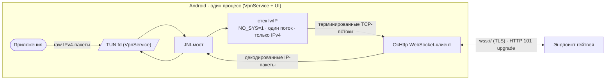
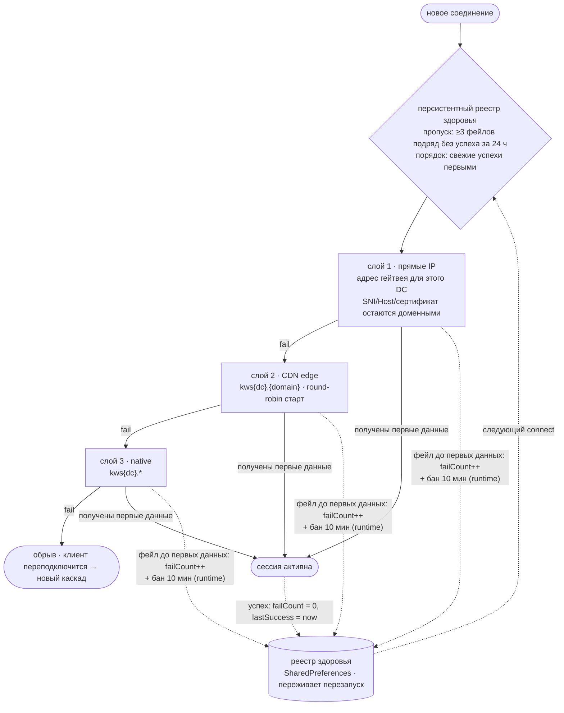

# WSBridge (RU)

IP-over-WebSocket релей для Android (VpnService).
English version: [README.md](README.md)

## Что делает

Приложение создаёт виртуальный сетевой интерфейс (TUN) и переносит IPv4-трафик
настроенных префиксов через него в виде WebSocket-потока:



1. Система направляет IPv4-трафик настроенных префиксов в TUN fd
   (`149.154.0.0/16`, `91.108.0.0/16`, `91.105.192.0/24` — остальной трафик
   не затрагивается).
2. Встроенный стек lwIP (2.2.0, однопоточный, `NO_SYS=1`, только IPv4)
   терминирует TCP и переизлучает каждый поток кадрами WebSocket.
3. Кадры передаются по TLS (`wss://`) HTTP-эндпоинту, который апгрейдит
   соединение (статус 101) и ретранслирует поток.
4. Ответы декодируются обратно в IP-пакеты и пишутся в TUN.

В отличие от iOS-оригинала IPC-слоя нет: сервис и UI живут в одном процессе,
журнал и статус читаются напрямую. У lwIP нет своего UDP, поэтому DNS из
туннеля форвардится `DNSForwarder` обычным UDP:53 на выбранный сервер.

64-байтный обфусцированный init-заголовок парсится на лету. Клиент не кладёт
`dc_idx` в него без секрета прокси, поэтому индекс DC берётся из адреса
назначения (встроенная таблица IP→DC), а байты `dc_idx` переписываются на
месте (XOR с keystream), чтобы совпасть с выбранным хостом гейтвея.

Дополнительные режимы (поле «CF Worker» в меню):
- **pipe** — собственный Cloudflare Worker: сырой TCP-поток уходит в WS,
  воркер сам коннектится к адресу назначения;
- **relay** — прямое реле на своём VPS: `host:port`, сырой TCP без CF и WS.

## Выбор эндпоинтов

Соединения устанавливаются через упорядоченный каскад:



- **Прямые IP** — адреса гейтвеев, доказанно обслуживающие этот DC (гейтвей
  выбирает сертификат по SNI, поэтому IP используется только там, где
  сертификат покрывает хост); TCP уходит на IP, а SNI/Host/валидация
  остаются доменными через кастомный DNS-резолвер.
- **CDN edge** — хосты `kws{dc}.{domain}`, резолвятся и ротируются
  round-robin; префикс живых эндпоинтов приоритетен.
- **Native** — гейтвей-хост `kws{dc}.*` как последний fallback; вариант
  хоста с `-1` обслуживает медиа-кластеры.

Реестр здоровья эндпоинтов переживает перезапуски: число фейлов подряд,
время последнего фейла и последнего успеха. Эндпоинты с ≥3 фейлами подряд
и без успеха за 24 ч исключаются до восстановления; свежие успехи пробуются
первыми. Runtime-кэш дополнительно банит упавший эндпоинт на 10 минут внутри
текущей сессии.

## Обновление списка эндпоинтов

Список эндпоинтов обновляется без пересборки приложения:

1. Приложение скачивает список с основного URL, с фолбэком на два
   CDN-зеркала (таймаут 10 с, обход кэша).
2. Каждая запись валидируется форматом и DNS-резолвом; список, где
   резолвится меньше 3 записей, отбрасывается как протухший.
3. Валидные записи мерджатся в персистентный реестр — встроенный список
   всегда первым, как неизменяемый fallback; известные живые не
   перетестируются, мёртвые получают DNS-ре-чек, мёртвые >7 дней и
   пропавшие из апстрима удаляются.
4. Реестр питает каскад при следующем старте туннеля. Автообновление —
   не чаще раза в 30 минут, после старта туннеля, не до него. Ручной пункт
   меню «Обновить фронты» показывает результат снэкбаром.

## DNS

DNS изнутри туннеля перехватывает и форвардит `DNSForwarder`. Транспорт
выбирает пользователь:

- **DoT** (DNS-over-TLS, RFC 7858) — **по умолчанию**. TLS напрямую к IP
  сервера на порт 853 с SNI; имя хоста не резолвится вообще, поэтому это
  самый надёжный транспорт, пока мы внутри туннеля.
- **DoH** (DNS-over-HTTPS, RFC 8484) — HTTPS POST, маскируется под обычный
  трафик, но требует предварительного резолва имени резолвера.
- **plain UDP:53** — фолбэк для серверов, у которых нет ни того, ни другого.

Пресеты: системный / Cloudflare / Google / Comss.one / Malw.link / GeoHide /
XBox DNS / Alt Malw.link, у каждого — ссылка на сайт провайдера. Свои
серверы требуют DoT-хост: незашифрованный резолвер перехватывается
провайдером, и смысл своего сервера теряется. Изменения применяются при
следующем старте туннеля.

## Установка

Скачай APK из [Releases](https://github.com/l1ratch/WSBridge-Android/releases);
дев-сборка последнего пуша в `main` — в prerelease `preview`. Все сборки
подписаны одним ключом, `versionCode` растёт — обновления ставятся поверх.
(Первый переход со старых debug-сборок потребует одного ручного удаления —
они были подписаны случайным ключом.)

## Сборка

Версия — два числа в `gradle.properties`: `wsb.build` — монотонный номер
сборки, кормит `versionCode`, и `wsb.version` — маркетинговая semver
(`0.3.0`), кормит `versionName`. Оба воркфлоу CI передают `wsb.build` как
`BUILD_NUMBER`, поэтому preview и релиз несут один растущий `versionCode` и
ставятся друг поверх друга. Релизный воркфлоу не собирается, если тег
(`v0.3.0`) не совпадает с `wsb.version` или если `wsb.build` оказался бы
ниже уже опубликованного preview, — номер поднимают в `gradle.properties`
с каждым пушем, а `wsb.version` меняют осознанно на релизах.

- Gradle wrapper; CI (GitHub Actions) собирает подписанный APK при каждом
  пуше в `main` и публикует в prerelease `preview`.
- Локально: JDK 17+ (в CI — 21), Android SDK 36, NDK 27+ / CMake. Нативная
  часть (lwIP 2.2.0 + JNI-мост, `app/src/main/cpp/`) собирается через
  externalNativeBuild.

```sh
./gradlew testDebugUnitTest assembleRelease
```

## Отличия от iOS-версии

- `PacketTunnelProvider` → `VpnService` (TUN fd вместо NEPacketFlow);
- `URLSessionWebSocketTask` → OkHttp WebSocket; прямые IP гейтвеев — через
  кастомный DNS-резолвер (SNI/Host/сертификат остаются доменными, TCP
  уходит на IP);
- нет IPC-слоя (Darwin notifications, JournalServer): сервис и UI в одном
  процессе, журнал читается напрямую;
- iOS отдаёт шифрованный DNS системе (`NEDNSOverTLSSettings` /
  `NEDNSOverHTTPSSettings`); Android реализует оба транспорта сам — DoT как
  TLS с SNI плюс кадрирование DNS-over-TCP, DoH через OkHttp — потому что
  системный private DNS недоступен `VpnService`. У DoT отключена проверка
  имени в сертификате: сокет коннектится к IP, и сертификат совпасть с ним
  не может; целостность даёт TLS, аутентичность — доверенный список IP;
- смена сети и напоминание о долгой сессии: iOS следит за `NWPathMonitor`
  в расширении туннеля и шлёт `UNUserNotificationCenter`; Android
  использует колбэки `ConnectivityManager`, владелец — сервис, плюс
  внутриэкранный алерт и действие «перезапустить»;
- индекс DC берётся из адреса назначения, а `dc_idx` переписывается в init
  (Android-клиент оставляет эти байты случайными без секрета прокси;
  iOS пишет их всегда).

## Лицензия

MIT © 2026 l1ratch. Портируемая логика —
[Flowseal/tg-ws-proxy](https://github.com/Flowseal/tg-ws-proxy) (MIT),
lwIP — BSD-подобная. Android-порт
[WSBridge-iOS](https://github.com/l1ratch/WSBridge-iOS).
